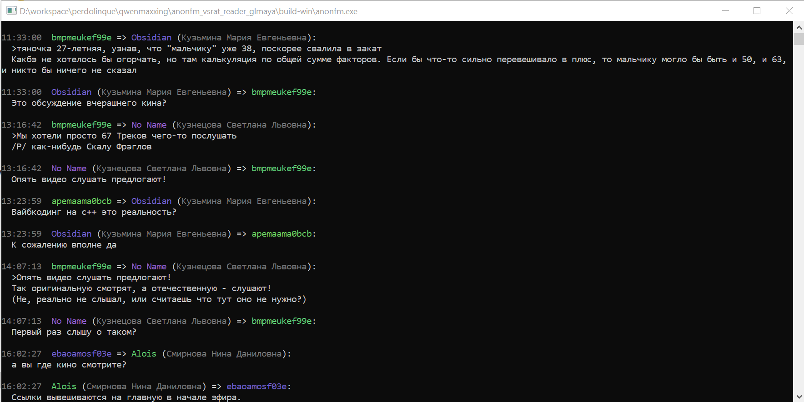

# anonfm-reader — консольная читалка кукарекалки Радио Анонимус

## Бенчмарк для локальной LLM
Это бенчмарк применения локальных LLM для vibe coding. Ну или vibrator coding, кому как удобно. Задача - проверка умения модели писать код на ANSI C, понимания неявного ТЗ (формат эндпоинта не описан, как и вообще наполнение), ситуативного планирования. 

* **Модель**: GLM-5.3-Flash-Maya-S24-IQ2_XXS_S
* **Харнесс**: Opencode 1.19

Промпт:
```
Задача создать консольную читалку для кукарекалки Радио Анонимус. Адрес anon.fm. Тебе необходимо на странице самосотятельно найти "кукарекалку" определить эндпоинт и его формат. При выводе сообщений в консоль необходимо визуально индетефицировать пользователей - раскрашивать ники уникальными индивидуальными цветами. 
Читалка должна иметь два режима: постоянный - автообновление и выдача новых сообщений и "once" выводит последние n сообщений и завершается.
Стек приложения: ANSI C (C89), WolfSSL. Остальные библиотеки, при необходимости, по твоему усмотрению.
Сборка: cmake на WSL2 (Ubuntu на нашей системе). Кроссплатформерная сборка под linux и windows.
Все комментарии в коде пишутся на simplified technical english (asd-ste100).
По готовности сделай к проекту README.md на русском языке. 
```

### Результаты

ТЗ выполнено хорошо, работает под linux и windows. Дезигн оригинальный, мне нравится.

## Что это
Кроссплатформенный консольный клиент кукарекалки [Радио Анонимус](https://anon.fm).
Читает ленту обменов «слушатель ↔ диджейка», печатает её в терминал с
раскраской ников и умеет работать в двух режимах.

Стек: **ANSI C (C89)**, **wolfSSL**, **CMake**. Внешних зависимостей
помимо wolfSSL нет — TCP-сокеты, HTTP и JSON написаны руками.

## Как устроена кукарекалка

Лента кукарекалки лежит по адресу `https://anon.fm/answers.js`. Это
JSON-массив строк вида:

```json
[
  ["0", "ник слушателя", "текст слушателя", "<span ...>ЧЧ:ММ:СС</span>",
   "ник диджейки", "текст ответа", "имя диджейки"],
  ["1", "!", "", "<span ...>ЧЧ:ММ:СС</span>",
   "ник диджейки", "сообщение диджейки", "имя диджейки"]
]
```

Поля каждой строки:

| № | Поле | Описание |
|---|------|----------|
| 0 | флаг | `"0"` — сообщение слушателя, `"1"` — сообщение диджейки |
| 1 | слушатель | ник слушателя или `"!"` у строк диджейки |
| 2 | сообщение | текст слушателя (с HTML-разметкой) |
| 3 | время | `<span class="timestamp">ЧЧ:ММ:СС.мс</span>` |
| 4 | диджейка | ник диджейки (`K`, `Obsidian`, `Alois`, …) |
| 5 | ответ | ответ диджейки или её сообщение в чате |
| 6 | имя | полное имя диджейки из эфира |

Новые строки появляются **в начале** массива, то есть массив отсортирован
от свежих к старым. HTTP-сервер отвечает `Content-Length`, без сжатия и
без чанков, поэтому клиент ходит простым `GET HTTP/1.0` поверх wolfSSL.

## Режимы

```text
anonfm auto          # по умолчанию: опрашивает ленту и печатает новые сообщения
anonfm once 30       # печатает последние 30 сообщений и завершается
```

* **auto** — при старте печатает последние 10 сообщений (меняется
  ключом `-n`), затем раз в 10 секунд (ключ `-i`) опрашивает ленту и
  печатает только новые сообщения в хронологическом порядке.
* **once** — печатает последние `n` сообщений (по умолчанию 20) и выходит.

### Опции

| Ключ | Значение |
|------|----------|
| `-n N` | число сообщений для `once` и глубина истории при старте `auto` |
| `-i SEC` | интервал опроса в секундах (для `auto`, по умолчанию 10) |
| `-c` | отключить цвета |
| `-C FILE` | PEM-бандл для проверки сертификата сервера |
| `-h` | справка |

### Цвета

Ник каждого участника раскрашен уникальным цветом: по нику считается
хэш FNV-1a, из него берётся оттенок (hue), а насыщенность и яркость
фиксированы. Один и тот же ник всегда получает один и тот же цвет, в
любом режиме и на любой платформе. Ники дидейки и слушателей различимы
даже при совпадении — цвет детерминирован, а не выбирается «по счётчику».

Вывод использует ANSI truecolor (`\e[38;2;R;G;Bm`) и отключается
ключом `-c`. В Windows-консоли автоматически включается режим UTF-8 и
escape-последовательности (ENABLE_VIRTUAL_TERMINAL_PROCESSING).

Пример вывода:

```text
13:44:57  aemndekab710 => K (Кузьмина Мария Евгеньевна):
  эльбрусское лобби значит

13:44:57  K (Кузьмина Мария Евгеньевна) => aemndekab710:
  Иншалла
```

## Сборка

### WSL2 / Ubuntu

Нужны cmake (≥ 3.13), gcc и wolfSSL (проверено на 5.7.4):

```sh
sudo apt install build-essential cmake libwolfssl-dev
mkdir build && cd build
cmake ..
make
```

Если wolfSSL установлен не в системные каталоги, укажите корень:

```sh
cmake -DWOLFSSL_ROOT=$HOME/wolfssl-install ..
```

Локальная сборка wolfSSL без прав root:

```sh
curl -sSL -o wolfssl.tar.gz \
  https://github.com/wolfSSL/wolfssl/archive/refs/tags/v5.7.4-stable.tar.gz
tar xzf wolfssl.tar.gz && cd wolfssl-5.7.4-stable
./configure --prefix=$HOME/wolfssl-install --enable-static --disable-shared
make -j4 && make install
# далее cmake -DWOLFSSL_ROOT=$HOME/wolfssl-install ..
```

### Windows (MSYS2 / MinGW / кросс-компиляция)

Готовый `anonfm.exe` собирается кроссом из WSL2 одним скриптом
(см. `build_wolfssl_win.sh` и `build_reader_win.sh`):

```sh
# 1) wolfSSL для Windows (статически, mingw-w64)
../wolfssl-5.7.4-stable/configure CC=x86_64-w64-mingw32-gcc \
    --host=x86_64-w64-mingw32 --prefix=$HOME/wolfssl-win-install \
    --enable-static --disable-shared --disable-debug --disable-examples
make -j && make install

# 2) читалка -> build-win/anonfm.exe
cmake -DCMAKE_SYSTEM_NAME=Windows -DCMAKE_SYSTEM_PROCESSOR=x86_64 \
      -DCMAKE_C_COMPILER=x86_64-w64-mingw32-gcc \
      -DWOLFSSL_ROOT=$HOME/wolfssl-win-install \
      -DCMAKE_EXE_LINKER_FLAGS=-static .. && make
```

Сборка в нативном Windows (MSYS2):

```sh
pacman -S mingw-w64-x86_64-toolchain mingw-w64-x86_64-cmake
# wolfSSL: соберите из исходников и укажите корень
./configure --prefix=C:/wolfssl --enable-static --disable-shared
cmake -DWOLFSSL_ROOT=C:/wolfssl .. && make
```

Подходит и `vcpkg install wolfssl` с `cmake -DCMAKE_TOOLCHAIN_FILE=...`.
На Windows линкуются `ws2_32` и `crypt32` (последняя — для загрузки
системного хранилища корневых сертификатов). При статической линковке
`-static` получается самодостаточный `anonfm.exe` без внешних DLL.

Код платформенно независим: `#ifdef _WIN32` только в сетевом и
консольном слоях. В Windows-консоли автоматически включаются режим
UTF-8 и escape-последовательности (ENABLE_VIRTUAL_TERMINAL_PROCESSING).

## Запуск

```sh
./anonfm once 15      # последние 15 сообщений и выход
./anonfm              # автообновление каждые 10 секунд
./anonfm auto -i 5 -n 20
./anonfm once 10 -c   # без цветов
```

## Замечания по безопасности

* Полный Mozilla CA bundle (`cacert.pem`, ~120 корней) **вшит в
  бинарник** (`src/ca_bundle.h`), поэтому проверка сертификата сервера
  (`SSL_VERIFY_PEER`) работает на любой системе без внешних
  зависимостей.
* Приоритет якорей: 1) PEM-бандл из `-C FILE`, 2) вшитый bundle,
  3) системное хранилище Windows / системные бандлы.
* Обновление вшитого бандла: `gen_ca_bundle.sh` скачивает свежий
  `https://curl.se/ca/cacert.pem` и перегенерирует заголовок.
* Имя хоста в сертификате дополнительно не сверяется (wolfSSL это
  делает только через callback); проверяется лишь цепочка до якоря.

## Структура проекта

```text
CMakeLists.txt     сборка (кроссплатформенная, gcc/clang/MSVC/MinGW)
src/main.c         режимы auto/once, разбор аргументов, вывод
src/net.c, net.h   TCP + wolfSSL + HTTP/1.0 GET
src/ca_bundle.h    Mozilla CA bundle, вшитый в бинарник
src/answer.c, .h   парсер JSON-ленты, снятие HTML-разметки
src/color.c, .h    детерминированные цвета ников
src/util.c, .h     буферы, строковые и платформенные мелочи
tests/test_answer.c  тесты парсера ленты (gcc -std=c89 -Isrc ...)
build_wolfssl.sh   сборка wolfSSL 5.7.4 для Linux без прав root
build_reader.sh    сборка читалки в WSL с локальным wolfSSL
build_wolfssl_win.sh  кросс-сборка wolfSSL для Windows (mingw-w64)
build_reader_win.sh   кросс-сборка -> build-win/anonfm.exe
```

Тесты:

```sh
gcc -std=c89 -Wall -Isrc -o test_answer tests/test_answer.c src/util.c
./test_answer
```

## Лицензия

MIT.
